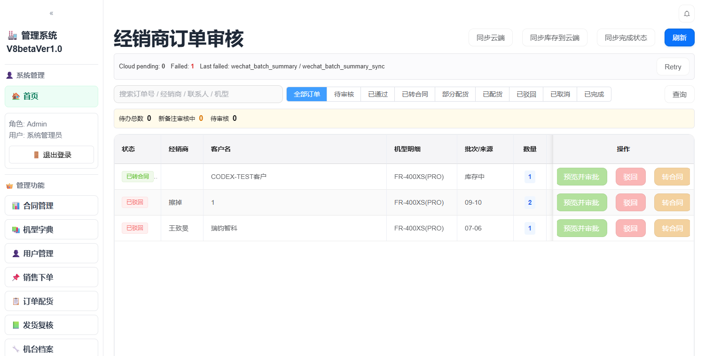
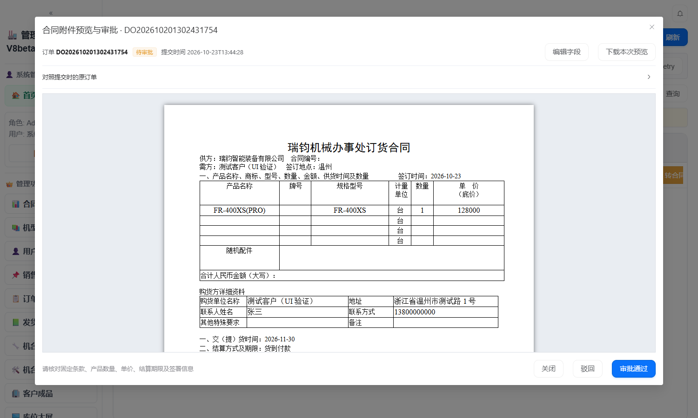

# 2026-10-23 更新说明：合同附件审批并入经销商订单行

## 本次范围

经销商订单审核页（`/dealer-orders`）取消顶部「合同附件审批」独立入口，把合同附件审批并入每张订单行，行内按钮由「通过」改为「预览并审批」。审批人只能看到当前这张订单的合同，预览界面右下角直接审批通过。

涉及模块：经销商订单审核（前端 + 合同草稿接口）。不涉及配货、入库、发货等其他模块的数据变更。

## 更新背景

原来合同附件审批有两个割裂的入口：

- 顶部「合同附件审批」打开的是**全量混列**的草稿列表，所有订单的合同挤在一页，审批人要先从里面找对应订单，再点「查看预览」，才能在第二个弹窗里审批。
- 行内「通过」只看得到订单数量和批次，看不到合同内容，等于"盲批"。

两个入口的判定口径也不一致，容易出现"订单已通过、附件还没归档"或反过来的情况。本次把两者收拢到一张订单上，一个入口、一次核对、一次通过。

## 功能变化

| 项目 | 更新前 | 更新后 |
| --- | --- | --- |
| 入口位置 | 页面顶部工具栏「合同附件审批」 | 每行订单操作列「预览并审批」 |
| 可见范围 | 所有订单的合同混在一起 | 仅当前订单的合同 |
| 打开后的界面 | 草稿列表 → 再点「查看预览」进二级弹窗 | 直接进入该订单的合同预览 |
| 生成预览 | 需手动点「生成预览」 | 打开时自动生成，直接出图 |
| 审批位置 | 二级弹窗底部 | 预览界面右下角 |
| 通过的含义 | 合同归档、订单通过是两个动作 | 一次「审批通过」= 订单通过 + 附件归档 |
| 版本切换 | 列表里翻找 | 顶部下拉切换同一订单的历史版本 |

## 新操作流程

1. 在经销商订单审核页找到待审核订单，点行内 **「预览并审批」**。
2. 弹窗打开即加载该订单的合同，按 Word 页面布局显示，可「下载本次预览」核对原文件。
3. 字段不全时点「编辑字段」补齐，补齐后才能审批。
4. 核对无误后，点右下角 **「审批通过」**，二次确认后系统先校验并通过对订单，再归档合同附件。
5. 有问题则点「驳回」并填写原因，只驳回合同附件，订单仍在待审核状态，可另行处理。

## 界面

订单列表：顶部已无「合同附件审批」，操作列改为「预览并审批 / 驳回 / 转合同」。

单订单合同预览与审批：标题带订单号，右下角为审批区。

## 业务规则

- **通过顺序为"先订单、后归档"**。先走订单通过（含可用数量校验），订单过不了就不动附件，避免出现"附件已归档但订单没通过"的死结。
- **库存不足会拦住审批**。提示形如"FR-400XS(PRO) 可用数量不足：需要 2，当前可用 0"，此时订单状态与合同附件均不变。
- **无合同草稿时保留原通过能力**。历史订单若从未同步过合同草稿，弹窗给出「直接审核订单」出口，走原来的订单通过流程，不会把流程卡死。
- **"新备注审核中"的订单不变**。这类订单的行内按钮仍显示「通过」，走原来的新备注复审接口，因为那一步不是合同审批，混进来会误归档附件。
- **多版本可切换**。同一订单若因订单内容变更产生多个草稿版本，默认选中最新未归档的一版，可在顶部下拉切换核对。

## 技术改动

| 文件 | 改动 |
| --- | --- |
| `api/routes/contract_drafts.py` | `GET /local` 新增 `order_no` 查询参数 |
| `crud/local_contract_drafts.py` | `list_drafts()` 新增 `order_no` 精确过滤，不传时保持原全量行为 |
| `frontend/src/components/ContractDraftReview.vue` | 由"全局列表 + 二级弹窗"重写为"单订单预览审批"，暴露 `openForOrder(orderNo)` |
| `frontend/src/views/DealerOrderReview.vue` | 删除顶部入口；行内与抽屉按钮改为「预览并审批」；操作列宽 260 → 300 |
| `frontend/vite.config.ts` | 新增 `VITE_SKIP_DTS` 开关，受限环境构建时可跳过 `*.d.ts` 生成 |

## 验证

- 接口过滤：造两条临时草稿，查 A 只返回 A、查 B 只返回 B、不传 `order_no` 返回全部；验证后已删除。
- TypeScript 检查（`vue-tsc --noEmit`）通过；Vite 构建通过。
- Playwright（系统 Edge）实测：顶部已无「合同附件审批」；行内按钮为「预览并审批 / 驳回 / 转合同」；弹窗标题为「合同附件预览与审批 · 订单号」；合同 iframe 正常渲染；右下角为「关闭 / 驳回 / 审批通过」。
- 库存不足分支：提示可用数量不足，合同附件**未**被归档，订单仍为待审核。
- 库存充足分支：订单置为 `approved`，草稿置为 `approved`，提示"审批通过，合同附件已归档"。
- 测试产生的订单状态、批次、`factory_plan` 临时行、`cloud_sync_outbox` 记录、合同草稿均已还原。

## 启用方式

- **后端需重启**以注册 `order_no` 参数，否则新入口会退化为返回全部草稿。
- 前端开发环境（Vite dev server）改动已随 HMR 生效，浏览器刷新即可；`dist/` 已重新构建。
- 无数据库结构变更，不需要迁移脚本。

## 注意事项与已知限制

1. **仅"待审核"订单可点**。已通过、已驳回的行按钮为置灰状态，暂不支持回看历史订单的合同附件。如需"任何状态都能查合同"，需要再加一个只读入口。
2. **审核备注暂不可填**。原「通过」弹窗可填写审核备注（默认带出订单备注），合并后统一用订单原备注，不再单独输入。如需保留备注输入，需要再补一个输入框。
3. **当前草稿表为空**。本地 `v8_contract_drafts` 无数据，验收时所有订单都会走「直接审核订单」兜底；真实数据需先执行「同步云端」生成草稿，才能看到合同预览。
4. **驳回只作用于合同附件**。订单本身的驳回仍走行内「驳回」按钮，两者互不影响。

## 回滚方式

前端：`frontend/dist` 已备份至 `frontend/dist_backup_20261023_1345/`，可直接覆盖回退。
代码：本次改动集中在上述 5 个文件，回退这 5 个文件即可；后端无数据结构变更，无需回滚数据库。

---

## 附：同日其他改动（与本次功能无关，供追溯）

| 内容 | 说明 |
| --- | --- |
| 配货页状态口径 | `/planning/orders` 新增 `allocatable` 参数与 `can_allocate` 字段，前端不再用 `sales_orders.status` 二次判断，消除"标签说已完成、列表还在等配货"的矛盾 |
| 订单删除闭环 | `save_orders` 支持按订单号局部写回，避免整表快照把已删除订单复活；`order-delete` 同步清理 `units` 预占 |
| 合同自动回滚 | 删除订单时，把"已转订单但无实际占用"的合同回滚为待规划，含 `{"现货(Spot)": n}` 这类非生产批次；真实生产批次仍走撤销规划 |
| 状态标签补全 | 新增「未关联合同」标签，区分"没挂合同"与"合同未规划"；标签配色按状态区分 |
| 数据修复 | 3 条被复活的订单改回 `deleted`，3 台残留 `units` 解绑，12 份合同回滚为待规划；按业务侧关闭空壳单 `SO-20260515-BFD2` |
