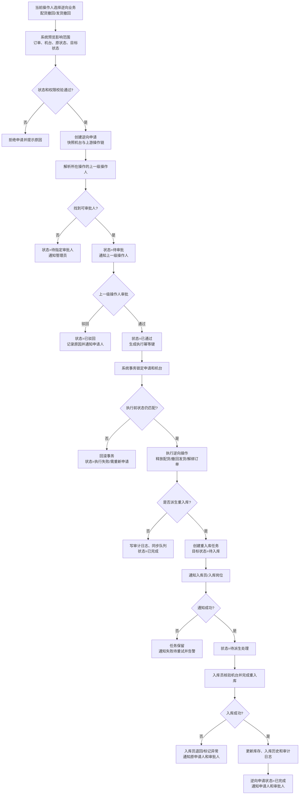
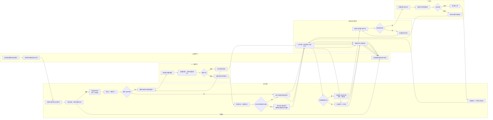

# 逆向审批流程和逆向派生操作通知

## 1. 需求理解

业务操作一旦向后推进，后续操作可能已经改变库存、订单和机台状态。配货撤回、发货撤回等“逆向操作”不能只由当前操作人直接执行，需要由该操作对应的上一级操作人进行审批把控。

逆向操作获批后，系统需要继续处理由回滚产生的派生任务。例如：配货或发货撤回使机台回到“待入库”，系统应自动生成“重入库”任务，并通知入库员处理；入库员完成重入库后，才闭合本次逆向链路。

当前系统已有发货撤回、订单配货释放、退回待入库、审计日志和同步队列能力。本需求是在这些能力之上增加统一的审批状态、审批责任人、任务通知和幂等约束。

## 2. 角色与责任

| 角色 | 责任 |
| --- | --- |
| 当前操作人 | 发起逆向申请，填写原因和机台范围；不能审批自己的申请 |
| 上一级操作人 | 审核逆向原因、范围和影响；审批通过或驳回 |
| 入库员 | 接收逆向派生的重入库任务，核验实物并完成入库 |
| 系统 | 校验状态、锁定申请、执行原子回滚、创建派生任务、发送通知并记录审计 |

“上一级操作人”应由组织/岗位权限配置解析，不能由前端传入后直接信任。找不到审批人时申请进入“待指定审批人”，禁止执行。

## 3. 统一状态模型

逆向申请状态：

`草稿 → 待审批 → 审批中 → 已通过/已驳回 → 执行中 → 待派生处理 → 已完成`

异常分支：

`执行失败`、`通知失败待重试`、`入库员拒收待处理`。

申请至少保存：申请单号、业务类型、业务单号、机台流水号快照、原状态、目标状态、申请人、上一级审批人、审批意见、执行时间、派生任务号、幂等键。

派生重入库任务至少保存：任务号、来源申请单号、机台流水号、当前状态、指派入库员/入库岗位、通知状态、入库结果和完成时间。

## 4. 主流程图

## 5. 泳道图

泳道之间的责任边界如下：当前操作人只负责发起，不能直接改变业务数据；业务系统负责审批人解析、状态校验和原子执行；上一级操作人只负责审批；通知服务负责消息和审计留痕；入库员只处理审批通过后产生的重入库派生任务。

## 6. 典型场景

### 6.1 配货撤回

1. 当前配货操作人提交撤回申请，系统检查订单是否已进入不可逆状态。
2. 上一级操作人审批通过后，事务内释放订单占用、解除机台与订单/批次绑定。
3. 若机台已完成生产但尚未形成可用库存，生成重入库任务并将机台置为“待入库”。
4. 入库员完成入库后，机台进入“库存中”，订单回到与剩余机台一致的可配货状态。

### 6.2 发货撤回

1. 当前发货操作人提交撤回申请，系统检查机台是否为“已出库”或允许恢复的客户仓库存状态。
2. 上一级操作人审批通过后，事务内执行发货撤回、恢复订单进度并写入发货撤回历史。
3. 需要重新回厂入库的机台生成重入库任务，通知入库员；无需回厂的机台可进入指定库存位置，但必须明确记录目标位置。
4. 入库完成后关闭派生任务，并向申请人、审批人发送结果。

## 7. 必须落实的规则

- **审批人来源**：后端按业务类型、岗位层级和原操作记录解析；申请人和审批人不得为同一人，除非配置明确允许代理审批。
- **范围不可漂移**：审批页展示申请时的机台快照；执行时重新锁定并校验，任何状态变化都使执行失败，不允许部分静默执行。
- **原子性**：业务回滚、订单状态、机台状态、历史记录和派生任务在同一事务内提交；失败全部回滚。
- **幂等性**：同一申请只能审批一次、执行一次；通知使用 `申请单号+任务类型+机台流水号` 幂等键，重复消费不得重复入库。
- **可追溯性**：记录申请人、审批人、执行人、原状态、目标状态、原因、时间和关联申请/任务号。
- **权限隔离**：发起、审批、执行、入库确认分别校验权限；审批接口不能仅依赖前端传入的用户名。
- **通知可靠性**：通知失败不撤销已提交的业务事务，任务进入待重试并告警；入库员未确认时不能把逆向申请标记为最终完成。
- **并发控制**：同一机台存在未完成逆向申请时禁止再次发起；审批和执行使用行锁或等价版本校验。

## 8. 验收标准

- 配货撤回和发货撤回都能生成逆向申请，并展示正确的上一级审批人。
- 未审批、被驳回、审批人缺失的申请不会改变订单或机台状态。
- 审批通过后，业务回滚与派生重入库任务在一次事务中产生；任一失败不会留下半完成数据。
- 重入库任务能在入库员工作台看到，并有站内/现有通知渠道的可重试通知。
- 入库员完成重入库后，库存、入库历史、审计日志和申请状态一致。
- 重复点击审批、执行、通知或入库确认不会重复改变库存或生成重复任务。
- 任意机台可从申请单追溯到原操作、审批记录、逆向执行记录和重入库结果。

## 9. 建议落地顺序

1. 建立逆向申请、审批记录、派生任务和通知记录的数据结构。
2. 抽取统一的逆向审批服务，接入配货撤回和发货撤回入口。
3. 将现有“退回待入库”逻辑改为审批通过后的事务步骤，并产出重入库任务。
4. 在入库员工作台增加待处理任务、确认/退回和异常原因。
5. 补充权限、并发、幂等、事务回滚和通知重试测试，再逐步开放业务入口。
