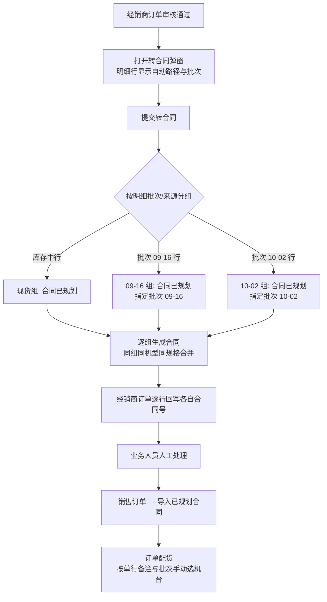

# 经销商订单转合同：按批次/来源自动选路与机台单行备注

整理日期：2026-10-28。依据当前工作区代码，未做线上联调。

## 1. 背景

经销商订单（`dealer_orders`）的每条明细都带「批次/来源」：

- `batch_no`：`FINISHED-STOCK` / `库存中` 表示现货，具体值（如 `09-16`、`10-02`）表示生产批次；
- `inventory_type`：`finished`（成品现货）、`wip`（在产批次）、`heightened`（加高批次）、`unmarked`（未标记）。

改造前，转合同弹窗让操作员手动选择「进入沙盘 / 进入生产看板 / 使用现货」，选择结果只影响合同状态，**与明细的批次/来源无关**；批次/来源只被写进合同的「指定批次/来源」，用于急单自动插单优先批次和合同管理页展示。

现在改为：**按每行明细的批次/来源自动判定路径**：

- 库存中行 → 合同「已规划」，人工到「销售订单 → 导入已规划合同」建单后配货；
- 具体批次行 → 合同同样「已规划」，并保留指定批次/来源，**不再进入沙盘预测**（沙盘读「待规划」合同时并不识别指定批次，会把显式批次需求重新预测到其他批次）；每个批次号单独一张合同。

机台分配仍由业务人员**人工配货**：在「订单配货」按需求行单行备注手动选择机台；指定批次只作参考与筛选线索，不做自动预占。人工配货确认后，单行备注写到机台合同备注。

## 2. 路径判定规则

判定与 `crud/dealer_orders.py::_is_finished_stock_order` 同口径，前后端各实现一份，必须保持一致：

| 明细行条件 | 判定 | 合同处理 |
| --- | --- | --- |
| `inventory_type` ∈ `finished / stock / 现货` | 库存中 | 「已规划」，多行合并为一张合同 |
| `batch_no` 为空（含未下发批次） | 库存中 | 「已规划」，多行合并为一张合同 |
| `batch_no` ∈ `FINISHED-STOCK / 库存中 / 现货 / 现货库存` | 库存中 | 「已规划」，多行合并为一张合同 |
| 其余（如 `09-16`） | 具体批次 | 「已规划」+ 指定批次；**每个批次号各一张合同** |

同一张经销商订单可以混合多种来源：例如「库存中 + 10-02 + 09-16」会生成 3 张合同（库存中一张、10-02 一张、09-16 一张），经销商订单逐行记录各自合同号。

## 3. 转合同流程



要点：

1. **按组生成合同**：库存中合并成一张；每个具体批次号各一张。同组内同机型同加高规格的明细行合并为一行并累加数量，加高与普通规格不合并。
2. **合同号**：前端预取的合同号给首行所在分组，其余分组按合同号尾部 4 位序号顺延（`HT...0001 → 0002 → 0003`），并校验不重复。
3. **全部「已规划」**：转合同后不再有「待规划」合同，避免显式批次需求进入沙盘预测；急单开关已从经销商转合同弹窗移除。
4. 合同总备注、逐行备注（`[总]/[备注]/[附加]/[改数]`）与附件归档逻辑不变。

## 4. 机台单行备注

实现：`utils/order_notes.py::single_line_order_remark`。

### 4.1 取值规则

合同行备注可能是多段拼接：

```
[总]整单备注 加高 [备注]原备注 [附加]附加备注 [改数]2
```

机台只保留**一行**可打印备注，优先级：

1. `[备注]` 原备注
2. `[附加]` 附加备注
3. 「加高」独立标记 / `[改数]` 改数量（两者都有时写成 `加高 改数2`）
4. 以上都没有时，把分段标记剥掉后的原文压成一行；`[总]` 整单备注不属于单行备注

换行、制表符和连续空格统一压成单个空格。历史/外部无分段备注原样保留。

### 4.2 展示与落库

- **订单配货页**：需求分解表新增「单行备注」列，按「机型 + 加高规格」汇总展示该行明细的单行备注；机台列表的「合同备注」列也按单行口径展示。
- **人工配货确认后**：`crud/orders.py::_build_model_note_map` 从订单关联的合同行取单行备注，`allocate_inventory` 把它写到机台的 `finished_goods_data.合同备注`（在产机台写 `units.order_remark`）。
- **落库保留分段前缀**：写到机台时，原备注存为 `[备注]原文`、附加备注存为 `[附加]原文`（`utils/order_notes.py::machine_remark_text`）。这样备注正文里的「加高」说明文字（例如「400G加高100mm 配单滤水箱」）不会被后续 `hasHighHint` 当成加高信号，避免普通机台被误判成加高；加高/改数本身是语义标记，按纯文本落库。库存查询、发货复核、仓库看板、机台修改、订单配货等展示列都用 `singleLineOrderRemark` 去掉前缀后显示。
- 订单明细接口（`GET /planning/orders/{order_id}/details`）每行同时返回原始 `备注` 与 `单行备注`，前端默认展示后者；加高判断仍用原始分段备注，避免说明文字里的「加高」误判。

## 5. 失败与回滚

转合同同一请求内只创建合同：

1. 后续合同创建失败时，删除本次已建合同、合同通知和未处理的急单卡；
2. 回写经销商订单失败时同样删除已建合同；
3. 回滚是补偿式而非跨模块原子事务（合同落库使用独立的整表重写逻辑），极端情况下失败点之后的外部副作用无法撤销。

因为不做自动配货/预占，不存在机台占用回滚问题。

## 6. 接口变更

`POST /api/v1/dealer-orders/{order_no}/convert-to-contract`

请求：

- `items` 每行新增 `batch_no`、`inventory_type`（前端从经销商订单行带入）；缺省时后端回退到订单行。
- `save_mode`、`is_rush` 已废弃（保留字段仅为兼容旧客户端，后端不再使用）。

响应：

```json
{
  "message": "已成功转为合同 HT202610280001、HT202610280002、HT202610280003；合同均已置「已规划」，请在销售订单导入后人工配货（指定批次：09-16、10-02，配货时按批次手动选择机台）",
  "contract_no": "HT202610280001、HT202610280002、HT202610280003",
  "contract_ids": ["HT202610280001", "HT202610280002", "HT202610280003"],
  "contracts": [
    {"contract_no": "HT202610280001", "path": "spot", "batch_no": "",
     "path_label": "库存中 → 现货直配（合同已规划）", "row_count": 2, "qty": 3, "models": ["FR-400G", "FH-300C"]},
    {"contract_no": "HT202610280002", "path": "batch", "batch_no": "09-16",
     "path_label": "批次 09-16 → 指定批次（合同已规划）", "row_count": 1, "qty": 1, "models": ["FR-400G"]},
    {"contract_no": "HT202610280003", "path": "batch", "batch_no": "10-02",
     "path_label": "批次 10-02 → 指定批次（合同已规划）", "row_count": 1, "qty": 2, "models": ["FH-300C"]}
  ],
  "save_mode": "auto"
}
```

原有 `cloud_attachments`、`order_form_attached_contracts` 保留；不再返回 `rush_created` / `rush_auto_inserted`。

`GET /api/v1/planning/orders/{order_id}/details` 的 `details` 每行新增 `单行备注`。

## 7. 前端入口

- 经销商订单审核页（`frontend/src/views/DealerOrderReview.vue`）：明细表新增「路径」列（显示到具体批次）；转合同弹窗去掉「保存方式」「急单」和多个提交按钮，只留「确认转合同」；成功后跳「销售订单 → 导入已规划合同」。
- 合同管理页「从经销商订单转为合同」（`frontend/src/views/ContractManage.vue`）：同样改为自动路径 + 单按钮，成功后切到「已规划」标签。该页的**手动批量录合同**仍保留原来的「保存方式」弹窗，不在本次改动范围。
- 订单配货页（`frontend/src/views/OrderAllocation.vue`）：需求分解表新增「单行备注」；机台合同备注按单行展示；候选机台的「批次号」列用于人工按指定批次勾选。
- 路径判定与文案集中在 `frontend/src/utils/dealerOrderItems.ts` 的 `isStockSourceLine` / `convertLinePathLabel`；单行备注视图逻辑在 `frontend/src/utils/orderNotes.ts`，与后端同口径。

## 8. 边界与未改变的行为

- **沙盘预测不读取「指定批次/来源」**：因此显式批次的合同不再以「待规划」进入沙盘；否则会被当成普通需求重新预测，导致指定批次失效。
- 显式批次不做自动预占；批次内机台被锁定（如沙盘锁卡）或加高规格不足时，由业务人员在订单配货/沙盘解锁后人工处理。
- 转合同仍要求经销商订单全部明细为「已通过」，附件归档、云端附件回传、订货单挂附件逻辑不变。
- 单行备注只影响机台展示和人工判别，不改变配货的机型/加高匹配规则。

## 9. 代码依据

- `api/routes/dealer_orders.py`：`_line_path`、`_build_convert_groups`（按批次分组）、`_unique_contract_no`、`convert_to_contract`、`_rollback_created_contracts`。
- `utils/order_notes.py`：`single_line_order_remark`、`machine_remark_text`。
- `crud/orders.py`：`_build_model_note_map`（人工配货时取单行备注写机台）、`allocate_inventory`。
- `api/routes/planning.py`：`_split_factory_plan_detail_rows`（返回单行备注）、`_sync_order_detail_rows_to_units_and_inventory`。
- `crud/dealer_orders.py`：`assign_dealer_order_line_contracts`、`_group_orders`、`_is_finished_stock_order`。
- `frontend/src/views/DealerOrderReview.vue`、`frontend/src/views/ContractManage.vue`、`frontend/src/views/OrderAllocation.vue`、`frontend/src/utils/dealerOrderItems.ts`、`frontend/src/utils/orderNotes.ts`。

## 10. 验证

- `tests/test_dealer_order_convert_auto_path.py`：路径判定、库存中/多批次拆合同、同批次合并、合同号顺延、单行备注优先级、订单明细接口单行备注、端点编排与失败回滚、逐行合同号回写。
- 全量后端测试：`python -m pytest tests -q`（271 passed，2 skipped）。
- 前端类型检查：`cd frontend && npx vue-tsc --noEmit -p tsconfig.json`。

以上为代码与本地测试层面的事实，未在真实业务库执行转合同写操作。
