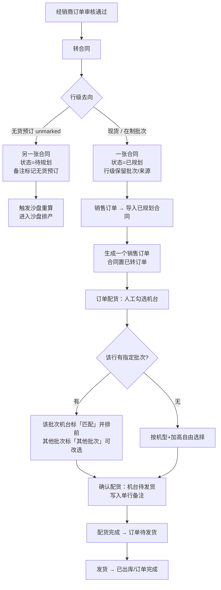

# 经销商订单转合同：按去向选路（现货/在制已规划、无货预订待规划进沙盘）

整理日期：2026-10-28，2026-10-29 增加「无货预订进沙盘」拆分规则。依据当前工作区代码，未做线上联调。

## 1. 背景与结论

经销商订单（`dealer_orders`）的每条明细都带「批次/来源」：

- `batch_no`：`FINISHED-STOCK` / `库存中` 表示现货，具体值（如 `08-04`、`09-16`）表示生产批次；
- `inventory_type`：`finished`（成品现货）、`wip`（在产批次）、`heightened`（加高批次）、`unmarked`（未标记）。

现场还有一张订单同时含「库存中 + 具体批次」的情况（如 `DO17930004560093AB857`：FH-300C/FH-300AUTO/FR-500XS 库存中，FR-400G 指定 08-04）。而 08-04 批次**已完工**，其加高机 `96-08-115` 就在库存中（E06）——这类"带批次号的库存机"如果按在产批次处理，会拆出多余的合同、绕远路。

因此当前定稿：

- **现货（库存中）与具体批次（在制）行合成一张「已规划」合同**（不按批次号拆合同）；
- **无货预订行（空批次 + `inventory_type=unmarked`）单独生成一张「待规划」合同**，触发沙盘重算，由沙盘排产；
- 已规划合同**不进入沙盘预测、不自动预占**，行级保留「指定批次/来源」，配货时作为**软约束**；
- 机台由业务人员在「订单配货」人工分配，人工配货后把单行备注写到机台合同备注；
- 一张经销商订单最多生成 2 张合同（已规划 + 待规划），回写订单行级合同号。

## 2. 转合同规则

| 明细行 | 合同处理 |
| --- | --- |
| 库存中（`finished/stock/现货`、空批次、`FINISHED-STOCK/库存中/现货/现货库存`） | 与在制行合并为一张合同；行级「指定批次/来源」留空 |
| 具体批次（如 `08-04`、`09-16`，不论批次已完工还是在产） | 与现货行合并为一张合同；行级「指定批次/来源」写 `{批次号: 数量}` |
| 无货预订（空批次 + `inventory_type=unmarked`） | **单独生成一张「待规划」合同**，行备注加「无货预订」，触发沙盘重算 |

要点：

1. **同机型同加高规格合并**为一行并累加数量；加高与普通规格不合并。
2. 现货/在制合同统一「已规划」；无货预订合同统一「待规划」，不再混在同一张合同里（一张合同只能有一个状态/一张销售订单）。
3. 合同号：沿用前端预取号；无货预订合同在同日序号上顺延。
4. 附件归档、订货单挂附件、云端附件回传逻辑不变。

## 3. 后续处理流程



人工配货完成后：

- 库存机台 `finished_goods_data` 置「待发货」，写占用订单号、客户、代理商、合同号、合同备注（单行备注）；
- 在产机台写 `units`（`contract_no/sales_id/customer/dealer_name/order_remark`）并同步库存镜像；
- 经销商订单行由 `_sync_allocation_status` 按机台统计回写为 `partial_allocated / allocated / completed`，并登记云端同步。

## 4. 指定批次软约束

实现：`api/routes/planning.py` 的 `_required_batches_by_variant` / `_batch_match_label`。

- 候选机台列表新增「批次匹配」列：
  - `匹配`：机台批次属于该订单行指定批次；
  - `其他批次`：同机型同加高但不是指定批次；
  - `-`：该变体没有指定批次。
- 候选排序：同机型内把「匹配」排前；**不阻止**业务人员改选「其他批次」。
- 配货接口返回 `batch_mismatch`（所选机台中非指定批次的清单），前端用警告提示；配货完成接口同样返回该清单。
- 加高判定与单行备注口径不变（见第 5 节）。

这样既尊重经销商指定的批次，又保留"人工判别分配"的灵活性（例如指定批次机台被锁/未入库时，可由业务人员改选其他批次并知晓风险）。

## 5. 机台单行备注

实现：`utils/order_notes.py`。

### 5.1 取值优先级

合同行备注可能是多段拼接：

```
[总]整单备注 加高 [备注]原备注 [附加]附加备注 [改数]2
```

1. `[备注]` 原备注
2. `[附加]` 附加备注
3. 「加高」独立标记 / `[改数]` 改数量（两者都有时写成 `加高 改数2`）
4. 都没有时，把分段标记剥掉后的原文压成一行；`[总]` 整单备注不属于单行备注

换行、制表符和连续空格统一压成单个空格；历史/外部无分段备注原样保留。

### 5.2 展示与落库

- **订单配货页**：需求分解表展示「单行备注」「指定批次」；候选机台展示「批次匹配」和单行口径的合同备注。
- **人工配货确认后**：`crud/orders.py::_build_model_note_map` 从订单关联合同行取单行备注，`allocate_inventory` 写到机台合同备注（在产机台写 `units.order_remark`）。
- **落库保留分段前缀**：原备注存 `[备注]原文`、附加备注存 `[附加]原文`（`machine_remark_text`），避免正文「加高」说明文字被后续 `hasHighHint` 误判；展示侧统一用 `singleLineOrderRemark` 去掉前缀。
- 订单明细接口（`GET /planning/orders/{order_id}/details`）每行返回原始 `备注`、`单行备注` 与 `指定批次/来源`。

## 6. 失败与回滚

转合同本次新建的合同（1～2 张）：创建或回写经销商订单失败时，删除本次已建的全部合同、合同通知和未处理的急单卡（补偿式回滚，非跨模块原子事务）。因为不做自动配货/预占，不存在机台占用回滚问题。

## 7. 接口变更

`POST /api/v1/dealer-orders/{order_no}/convert-to-contract`

请求：

- `items` 每行可带 `batch_no`、`inventory_type`（前端从经销商订单行带入），缺省时后端回退到订单行；
- `save_mode`、`is_rush` 已废弃（保留字段仅为兼容旧客户端）。

响应（订单同时含现货/在制与无货预订时返回两张合同）：

```json
{
  "message": "已成功转为合同：HT202610280001（已规划，请在销售订单导入后人工配货）；HT202610280009（无货预订，待规划，已进入沙盘排产）；指定批次：08-04（配货时优先匹配，可改选）",
  "contract_no": "HT202610280001、HT202610280009",
  "contract_ids": ["HT202610280001", "HT202610280009"],
  "contracts": [
    {"contract_no": "HT202610280001", "path": "auto", "status": "已规划",
     "batch_nos": ["08-04"],
     "path_label": "按明细来源自动选路（合同已规划）",
     "row_count": 3, "qty": 5,
     "models": ["FH-300C", "FR-400G", "FR-400AUTO"]},
    {"contract_no": "HT202610280009", "path": "preorder", "status": "待规划",
     "batch_nos": [],
     "path_label": "无货预订（合同待规划，进入沙盘）",
     "row_count": 1, "qty": 3,
     "models": ["FR-500XS(PRO)"]}
  ],
  "save_mode": "auto"
}
```

`cloud_attachments`、`order_form_attached_contracts` 保留；不再返回 `rush_created` / `rush_auto_inserted`。

配货相关：

- `GET /planning/orders/{order_id}/allocations` 的候选行新增 `_batch_match`（`匹配` / `其他批次` / 空）；
- `POST /planning/orders/{order_id}/allocate`、`POST .../complete-allocation` 返回 `batch_mismatch` 列表。

## 8. 前端入口

- 经销商订单审核页（`frontend/src/views/DealerOrderReview.vue`）：明细表「路径」列显示 `库存中 → 库存配货` / `批次 X → 优先按批次配货` / `无货预订 → 待规划（沙盘）`；转合同弹窗只留「确认转合同」，成功后：有已规划合同 → 跳「销售订单 → 导入已规划合同」；仅无货预订 → 跳「合同管理」查看待规划合同。
- 合同管理页「从经销商订单转为合同」（`frontend/src/views/ContractManage.vue`）：同上，成功后按返回的合同状态切换「已规划」/「待规划」标签。该页的手动批量录合同仍保留原「保存方式」弹窗。
- 订单配货页（`frontend/src/views/OrderAllocation.vue`）：需求分解新增「单行备注」「指定批次」；候选机台新增「批次匹配」，选到其他批次时弹警告。
- 单行备注视图逻辑在 `frontend/src/utils/orderNotes.ts`，与后端同口径；无货预订判定在 `frontend/src/utils/dealerOrderItems.ts`。

## 9. 边界与未改变的行为

- **指定批次是软约束**：不阻止改选其他批次；如需改为硬约束（只能配指定批次）可在此基础加校验开关。
- **无货预订**只认「空批次 + `inventory_type=unmarked`」；空批次但类型为 finished/空的历史/外部订单仍按现货处理（10-23 修复，避免外部订单全部审不过）。
- 无货预订行在审核时跳过库存可用量校验；现货/在制行仍按 `wechat_batch_summary` 校验。
- 沙盘预测不读取「指定批次/来源」；现货/在制合同仍以「已规划」进入后续导入/配货，不进入沙盘。
- 批次是否完工不影响现货/在制合同的配货：已完工批次的机台通常已进入库存/待入库，直接在订单配货里选即可。
- 转合同仍要求经销商订单全部明细「已通过」；不做自动预占（自动批次规划为后续二期能力）。
- 单行备注只影响机台展示与人工判别，不改变机型/加高匹配规则。

## 10. 代码依据

- `api/routes/dealer_orders.py`：`_line_path`、`_build_convert_contract`（按去向分组）、`_next_contract_no_after`、`convert_to_contract`、`_rollback_created_contracts`。
- `api/routes/planning.py`：`_process_contracts_batch`（支持 `status_overrides` / `trigger_sandbox`）、`_required_batches_by_variant`、`_batch_match_label`、`_order_batch_mismatches`、`_get_order_contract_machine_rows`（候选与批次匹配）、`_split_factory_plan_detail_rows`（单行备注/指定批次）。
- `crud/orders.py`：`_build_model_note_map`、`allocate_inventory`、`revert_to_inbound`。
- `crud/dealer_orders.py`：`is_preorder_dealer_order_line`、`dealer_order_line_route`、`_group_orders`、`_sync_allocation_status`、`_is_finished_stock_order`。
- `utils/order_notes.py`、`frontend/src/utils/orderNotes.ts`、`frontend/src/utils/dealerOrderItems.ts`。

## 11. 验证

- `tests/test_dealer_order_convert_auto_path.py`：单合同生成、无货预订拆分为待规划合同、行级批次来源、同规格合并、单行备注、转合同端点与回滚、指定批次匹配标记、订单级合同号聚合。
- `tests/test_dealer_order_preorder_routing.py`：无货预订/现货/批次三类判定（含空批次历史单兜底）。
- 全量后端测试：`python -m pytest tests -q`。
- 前端类型检查：`cd frontend && npx vue-tsc --noEmit -p tsconfig.json`。

以上为代码与本地测试层面的事实，未在真实业务库执行转合同写操作。
