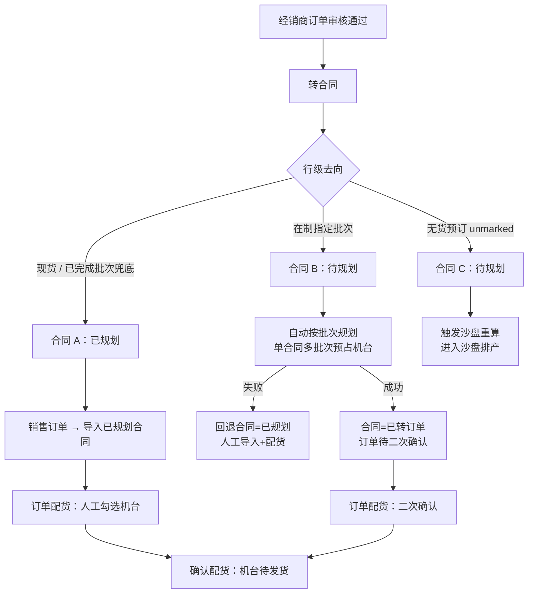

# 经销商订单转合同：按去向选路（现货已规划 / 在制自动批次规划 / 无货预订进沙盘）

整理日期：2026-10-28；2026-10-29 增加「无货预订进沙盘」与「在制多批次自动规划」。依据当前工作区代码，未做线上联调。

## 1. 背景与结论

经销商订单（`dealer_orders`）的每条明细都带「批次/来源」：

- `batch_no`：`FINISHED-STOCK` / `库存中` 表示现货；具体值（如 `10-02`、`09-16`）表示生产批次；
- `inventory_type`：`finished`（成品现货）、`wip`（在产批次）、`heightened`（加高批次）、`unmarked`（无货预订/未来排产）。

当前定稿按「后续能不能直接安排」分三类，最多生成三张合同：

| 去向 | 判据 | 合同状态与后续 |
| --- | --- | --- |
| 现货 | 库存中/现货别名，或 `finished/stock/现货` | 一张「已规划」合同；业务在「销售订单 → 导入已规划合同」建单后到「订单配货」人工分配机台 |
| 在制（指定批次） | 有具体批次，且本地批次状态为 `Confirmed/In_Production` | 一张「待规划」合同；转合同时**自动执行按批次规划（支持单合同多批次）**：预占机台、生成待二次确认订单，合同置「已转订单」 |
| 无货预订 | 空批次 + `inventory_type=unmarked` | 一张「待规划」合同；触发沙盘重算，进入沙盘排产 |
| 已完成/不存在批次 | 批次状态为 `Completed` 或本地查不到 | 不能做批次插入，回退到现货合同（「已规划」）人工配货；批次保留为软约束提示 |

要点：

1. 同机型同加高规格合并为一行并累加数量；加高与普通规格不合并。
2. 一张合同只能有一个状态、一张销售订单，所以不同去向必须分合同；同类去向仍合并为一张，不按每个批次拆合同。
3. 自动批次规划失败（空卡不足、规格不匹配等）**不阻塞整单**：该合同回退「已规划」，由业务人工导入+配货，并返回失败原因。
4. 现货/在制合同不做自动预占；在制自动规划仍需人工「二次确认」后才进入待发货。
5. 合同号：沿用前端预取号；后续合同在同日序号上顺延。

## 2. 转合同规则

| 明细行 | 合同处理 |
| --- | --- |
| 库存中（`finished/stock/现货`、`FINISHED-STOCK/库存中/现货/现货库存`） | 合并为一张「已规划」合同；行级「指定批次/来源」留空 |
| 具体批次且批次 `Confirmed/In_Production` | 单独一张「待规划」合同；行级「指定批次/来源」写 `{批次号: 数量}`，转合同后自动多批次规划 |
| 具体批次但批次 `Completed`/不存在 | 归入现货「已规划」合同；行级保留批次，供人工配货时匹配 |
| 无货预订（空批次 + `inventory_type=unmarked`） | 单独一张「待规划」合同；行备注加「无货预订」，触发沙盘 |

## 3. 后续处理流程



## 4. 指定批次与软约束

- **在制自动规划**：按合同行「指定批次/来源」逐批校验本地 `batches`：
  - 批次必须 `Confirmed/In_Production`，且批次空卡能凑齐该批次需求；任一不满足则整张合同回退「已规划」；
  - 一张合同可同时预占多个批次；`sales_orders.指定批次/来源` 的 `_batch_plan` 元数据保存批次列表、机台列表与原值，供改配/撤销/二次确认使用；
  - 已完成批次不能做批次插入（不在产线），因此不会进入自动规划。
- **人工配货（现货/回退合同）**：候选机台列表把指定批次机台标「匹配」排前，其他批次标「其他批次」可改选；配货接口返回 `batch_mismatch` 警告。
- 多批次预占的整体改配暂不支持（需先撤销再重新规划），撤销/二次确认、改配单批次仍可用。

## 5. 机台单行备注

### 5.1 取值优先级

合同行备注可能是多段拼接：

```
[总]整单备注 加高 [备注]原备注 [附加]附加备注 [改数]2
```

1. `[备注]` 原备注
2. `[附加]` 附加备注
3. 「加高」独立标记 / `[改数]` 改数量
4. 都没有时剥掉分段标记后压成一行；`[总]` 整单备注不属于单行备注

### 5.2 展示与落库

- **订单配货页**：需求分解展示「单行备注」「指定批次」；候选机台展示「批次匹配」。
- **人工配货确认后**：`crud/orders.py::_build_model_note_map` 取单行备注，`allocate_inventory` 写到机台合同备注（在产机台写 `units.order_remark`）。
- **落库保留分段前缀**：原备注存 `[备注]原文`、附加备注存 `[附加]原文`，避免正文「加高」被误判。
- 订单明细接口每行返回原始 `备注`、`单行备注` 与 `指定批次/来源`。

## 6. 失败与回滚

- 建合同失败：删除本次已建的全部合同、合同通知和未处理的急单卡（补偿式回滚，非跨模块原子事务）。
- 在制自动批次规划失败：整张合同回滚为「已规划」（不再自动改选其他批次），接口返回失败原因，业务人工导入+配货。
- 自动规划成功但后续二次确认失败：沿用既有预占确认链路，机台保持预占，业务可改配/撤销。

## 7. 接口变更

`POST /api/v1/dealer-orders/{order_no}/convert-to-contract`

请求：

- `items` 每行可带 `batch_no`、`inventory_type`（前端从经销商订单行带入），缺省时后端回退到订单行；
- `save_mode`、`is_rush` 已废弃（保留字段仅为兼容旧客户端）。

响应（示例：现货 + 在制 + 无货预订各一行）：

```json
{
  "message": "已成功转为合同：HT202610280001（已规划，请在销售订单导入后人工配货）；HT202610280009（在制批次已自动规划，订单 SO-20261029-AB12 待二次确认）；HT202610280010（无货预订，待规划，已进入沙盘排产）",
  "contract_no": "HT202610280001、HT202610280009、HT202610280010",
  "contract_ids": ["HT202610280001", "HT202610280009", "HT202610280010"],
  "contracts": [
    {"contract_no": "HT202610280001", "path": "auto", "status": "已规划",
     "batch_nos": [], "path_label": "按明细来源自动选路（合同已规划）",
     "row_count": 2, "qty": 2, "models": ["FH-300C"]},
    {"contract_no": "HT202610280009", "path": "batch-plan", "status": "已转订单",
     "batch_nos": ["10-02"], "path_label": "在制批次（自动批次规划，待二次确认）",
     "row_count": 1, "qty": 1, "models": ["FR-400AUTO"]},
    {"contract_no": "HT202610280010", "path": "preorder", "status": "待规划",
     "batch_nos": [], "path_label": "无货预订（合同待规划，进入沙盘）",
     "row_count": 1, "qty": 3, "models": ["FR-400G"]}
  ],
  "save_mode": "auto",
  "batch_plan": {"attempted": true, "ok": true, "order_id": "SO-20261029-AB12",
                 "batch_codes": ["10-02"], "error": null}
}
```

自动规划失败时：`batch_plan.ok=false`、该合同 `path=batch-plan-fallback`、`status=已规划`，`error` 带失败原因。

`cloud_attachments`、`order_form_attached_contracts` 保留。

## 8. 前端入口

- 经销商订单审核页（`frontend/src/views/DealerOrderReview.vue`）：
  - 明细「路径」列：`库存中 → 库存配货` / `批次 X → 自动批次规划` / `无货预订 → 待规划（沙盘）`；
  - 转合同成功后：有自动规划合同 → 「订单配货」二次确认；有已规划合同 → 「销售订单 → 导入已规划合同」；仅无货预订 → 「合同管理」待规划。
- 合同管理页（`frontend/src/views/ContractManage.vue`）：同上；成功后按返回合同状态切「已完成/已规划/待规划」tab。
- 订单配货页（`frontend/src/views/OrderAllocation.vue`）：预占详情增加多批次展示（`batch_codes`），多批次预占不支持整体改配，可撤销后重规划。
- 无货预订判定在 `frontend/src/utils/dealerOrderItems.ts`。

## 9. 边界与未改变的行为

- 无货预订只认「空批次 + `inventory_type=unmarked`」；空批次但类型 finished/空的历史/外部订单仍按现货处理（10-23 修复）。
- 无货预订行审核时跳过库存可用量校验；现货/在制行仍按 `wechat_batch_summary` 校验。
- 已完成批次不能做批次插入，归现货合同人工配货；如需彻底禁止，应在云端大区经理分配候选过滤。
- 自动批次规划只使用合同「指定批次/来源」里的批次，不会自动改选其他批次。
- 在制自动规划仍要人工二次确认；确认前不写 `finished_goods_data` 待发货。
- 单行备注只影响机台展示与人工判别，不改变机型/加高匹配规则。

## 10. 代码依据

- `api/routes/dealer_orders.py`：`_line_path`、`_build_convert_contract`、`_load_batch_status_map`、`_next_contract_no_after`、`_mark_contract_planned`、`convert_to_contract`。
- `api/routes/planning.py`：`_process_contracts_batch`（`status_overrides` / `trigger_sandbox`）、`_required_batches_by_variant`、`_batch_match_label`、`_order_batch_mismatches`。
- `crud/batch_planning.py`：`plan_contract`（人工单批次）、`plan_contract_designated_batches`（自动多批次）、`confirm_review`、`change_reservation`、`reservation_info`。
- `crud/dealer_orders.py`：`is_preorder_dealer_order_line`、`dealer_order_line_route`、`approve_dealer_order`、`_group_orders`、`_sync_allocation_status`。
- `utils/order_notes.py`、`frontend/src/utils/orderNotes.ts`、`frontend/src/utils/dealerOrderItems.ts`。

## 11. 验证

- `tests/test_dealer_order_convert_auto_path.py`：现货/在制/无货预订分组、纯预订、自动规划成功与失败回退、合同号顺延、行级批次来源、单行备注、订单级合同号聚合。
- `tests/test_dealer_order_preorder_routing.py`：无货预订/现货/批次三类判定与空批次历史单兜底。
- `tests/test_batch_planning.py`：单批次人工规划回归 + 单合同多批次自动规划、已完成/不存在批次拒绝、重放幂等。
- 全量后端测试：`python -m pytest tests -q`。
- 前端类型检查/构建：`cd frontend && npm run build`。

以上为代码与本地测试层面的事实，未在真实业务库执行转合同写操作。
