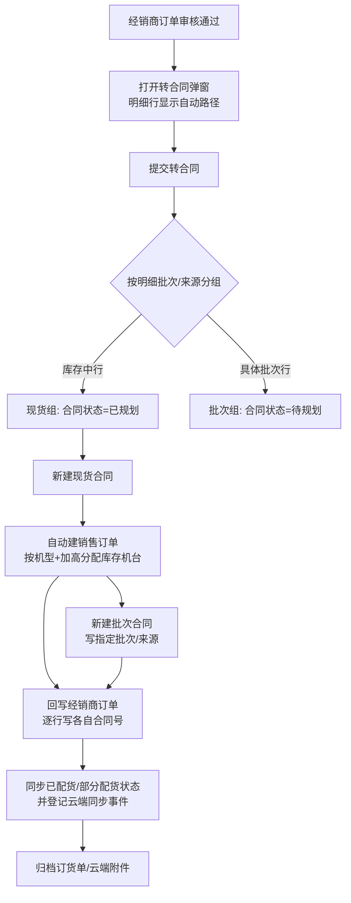

# 经销商订单转合同：按批次/来源自动选路与库存自动配货

整理日期：2026-10-28。依据当前工作区代码，未做线上联调。

## 1. 背景

经销商订单（`dealer_orders`）的每条明细都带「批次/来源」：

- `batch_no`：`FINISHED-STOCK` / `库存中` 表示现货，具体值（如 `09-10`、`10-02`）表示生产批次；
- `inventory_type`：`finished`（成品现货）、`wip`（在产批次）、`heightened`（加高批次）、`unmarked`（未标记）。

改造前，转合同弹窗让操作员手动选择「进入沙盘 / 进入生产看板 / 使用现货」，选择结果只影响合同状态，**与明细的批次/来源无关**；「使用现货」也只是把合同置为「已规划」，之后仍要人工到「销售订单 → 导入已规划合同」建单、再到「订单配货」勾机台。批次/来源只被写进合同的「指定批次/来源」，用于急单自动插单优先批次和合同管理页展示，不决定路径。

现在改为：**按每行明细的批次/来源自动判定路径**；库存中行在转合同成功后，同一请求内自动建销售订单并分配库存机台。

## 2. 路径判定规则

判定与 `crud/dealer_orders.py::_is_finished_stock_order` 同口径，前后端各实现一份，必须保持一致：

| 明细行条件 | 判定 | 路径 |
| --- | --- | --- |
| `inventory_type` ∈ `finished / stock / 现货` | 库存中 | 现货直配 |
| `batch_no` 为空（含未下发批次） | 库存中 | 现货直配 |
| `batch_no` ∈ `FINISHED-STOCK / 库存中 / 现货 / 现货库存` | 库存中 | 现货直配 |
| 其余（如 `09-10`） | 具体批次 | 沙盘待规划 |

同一张经销商订单可以混合两种来源，例如库中真实数据就存在「库存中 + 10-02 批次」同一订单的情况。

## 3. 转合同流程



要点：

1. **同路径合并**：同一路径的多条明细只生成**一张**合同；同机型同加高规格的明细行合并为一行并累加数量，加高与普通规格不合并。
2. **混合订单拆两张合同**：现货组一张、批次组一张。前端预取的合同号给首行所在路径，另一张按合同号尾部 4 位序号顺延（如 `HT202610280001` → `HT202610280002`），并校验不重复。
3. **现货组先建先配**：先建现货合同并完成自动配货，再建批次合同；任一步失败按第 5 节回滚。
4. **批次组仍走沙盘**：合同「待规划」，`指定批次/来源` 保留 `{批次号: 数量}`，急单开关与急单卡逻辑不变。

## 4. 库存中行的自动配货规则

实现：`crud/spot_allocation.py::allocate_spot_contract`。

- 只处理 `finished_goods_data` 中 `状态 LIKE '库存中%'`、`占用订单号` 为空、`合同号` 为空的机台，按流水号稳定顺序选取。
- 机台匹配按「基础机型 + 加高」：机型剥掉 `(加高)` 后缀；加高看机型后缀、`批次号`、`合同备注` 的加高信号（与库存页/转合同口径一致）。普通规格与加高规格互不占用。
- 在同一数据库事务内：建销售订单（`status=ready` 配齐 / `active` 有缺口）、把合同行置「已转订单」并写订单号、把命中的机台置「待发货」并写占用订单号/客户/代理商/合同号/合同备注、写合同转订单通知。
- **配齐部分直接配货，缺口原样回传**：返回 `shortages`（机型、是否加高、需求、已配、缺口），前端用警告提示，缺口留给人工在「订单配货」中补配。
- 配货完成后调用 `sync_dealer_order_statuses_by_sales_orders`，按实际机台把经销商订单行更新为 `partial_allocated / allocated`，并登记云端同步事件。
- 混合订单会把每行的合同号写回各自所属合同（`assign_dealer_order_line_contracts`），避免按机型汇总时把另一张合同的配货算到本行。

## 5. 失败与回滚

转合同同一请求内同步执行，异常时回滚本次新建数据，避免留下半成品单据：

1. 现货合同已建、批次合同建失败 → 先 `rollback_spot_allocation` 释放机台、删除销售订单、合同恢复「已规划」，再删除本次已建合同、合同通知和未处理的急单卡；
2. 回写经销商订单失败 → 同样回滚配货与已建合同；
3. 回滚只做补偿，不掩盖原始错误；调用方返回 422/500 并带出失败原因。

注意：回滚是补偿式而非跨模块原子事务（合同落库使用独立的整表重写逻辑），极端情况下失败点之后的急单卡/沙盘重算等外部副作用无法撤销。

## 6. 接口变更

`POST /api/v1/dealer-orders/{order_no}/convert-to-contract`

请求：

- `items` 每行新增 `batch_no`、`inventory_type`（前端从经销商订单行带入）；缺省时后端回退到订单行。
- `save_mode` 已废弃（保留字段仅兼容旧客户端，后端不再据此选路）。

响应新增：

```json
{
  "contract_no": "HT202610280001、HT202610280002",
  "contract_ids": ["HT202610280001", "HT202610280002"],
  "contracts": [
    {"contract_no": "HT202610280001", "path": "spot", "path_label": "库存中 → 现货直配（合同已规划）",
     "row_count": 2, "qty": 3, "models": ["FR-400G", "FH-300C"]},
    {"contract_no": "HT202610280002", "path": "batch", "path_label": "批次 → 沙盘待规划",
     "row_count": 1, "qty": 2, "models": ["FR-400G"]}
  ],
  "auto_allocation": {
    "contract_no": "HT202610280001",
    "order_id": "SO-20261028-AB12",
    "required_qty": 3,
    "allocated_qty": 2,
    "status": "active",
    "shortages": [{"model": "FR-400G", "high": true, "need": 1, "allocated": 0, "shortage": 1}],
    "serials": ["SN-001", "SN-002"],
    "message": "已自动配货 2/3 台，订单 SO-20261028-AB12；未配齐：FR-400G（加高）缺 1"
  },
  "auto_allocated_qty": 2,
  "auto_shortage_qty": 1,
  "save_mode": "auto"
}
```

`auto_allocation` 在没有库存中行时为 `null`。原有 `rush_created`、`rush_auto_inserted`、`cloud_attachments`、`order_form_attached_contracts` 保留。

## 7. 前端入口

- 经销商订单审核页（`frontend/src/views/DealerOrderReview.vue`）：明细表新增「路径」列；转合同弹窗去掉「保存方式」和两个提交按钮，只留「确认转合同」；成功后提示自动配货台数与缺口。
- 合同管理页「从经销商订单转为合同」（`frontend/src/views/ContractManage.vue`）：同样改为自动路径 + 单按钮。该页的**手动批量录合同**仍保留原来的「保存方式」弹窗，不在本次改动范围。
- 路径判定与文案集中在 `frontend/src/utils/dealerOrderItems.ts` 的 `isStockSourceLine` / `convertLinePathLabel`。
- 跳转：有自动配货订单 → 「销售订单」；只有批次路径 → 沙盘/生产看板；否则留在本页。

## 8. 边界与未改变的行为

- 具体批次行不会自动按批次预占机台，仍由沙盘/合同管理的「按批次规划并配货」处理；指定批次作为优先项写入合同。
- 库存不足不阻断转合同，配齐部分直接配货，缺口留人工补配。
- 库存中行不再把 `FINISHED-STOCK/库存中` 写进合同「指定批次/来源」（来源已在自动配货中消费）。
- 转合同仍要求经销商订单全部明细为「已通过」，附件归档、云端附件回传、订货单挂附件逻辑不变。
- 自动配货只处理库存中机台；在产机台（units）的分配仍走原有配货/批次规划流程。

## 9. 代码依据

- `api/routes/dealer_orders.py`：`_line_path`（路径判定）、`_build_convert_groups`（分组与合并）、`_unique_contract_no`（拆路合同号）、`convert_to_contract`（编排）、`_rollback_created_contracts`（补偿）。
- `crud/spot_allocation.py`：`allocate_spot_contract`、`_stock_candidates`、`rollback_spot_allocation`。
- `crud/dealer_orders.py`：`assign_dealer_order_line_contracts`、`_group_orders`（订单级合同号聚合）、`_is_finished_stock_order`（来源判定口径）。
- `frontend/src/views/DealerOrderReview.vue`、`frontend/src/views/ContractManage.vue`、`frontend/src/utils/dealerOrderItems.ts`。

## 10. 验证

- `tests/test_dealer_order_convert_auto_path.py`：路径判定、混合订单拆分与同路径合并、合同号顺延、现货自动配货（配齐/缺口/加高隔离/回滚）、端点编排与失败回滚、逐行合同号回写。
- 全量后端测试：`python -m pytest tests -q`（270 passed，2 skipped）。
- 前端类型检查：`cd frontend && npx vue-tsc --noEmit -p tsconfig.json`。

以上为代码与本地测试层面的事实，未在真实业务库执行转合同写操作。
